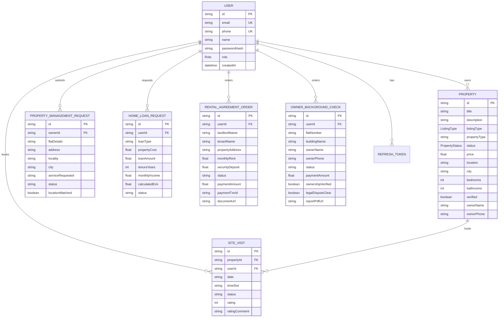

# Seedha Properties — Database Design & Schema Specification

## 1. Relational Database Overview
The Seedha Properties PostgreSQL database is designed with normalized entities supporting high concurrency, transactional integrity, and strong foreign key constraints.

---

## 2. Entity Relational Diagram (Mermaid)

---

## 3. Financial Integrity & Decimal Safety
- Monetary columns (`price`, `monthlyRent`, `securityDeposit`, `paymentAmount`, `loanAmount`, `calculatedEmi`) are isolated from client-side manipulation.
- All payments must pass verified server-side callbacks with idempotency tokens before records change to `PAID` or documents are unlocked.
- Duplicate site visits are strictly prevented via composite uniqueness: `(propertyId, userPhone, date, timeSlot)`.
